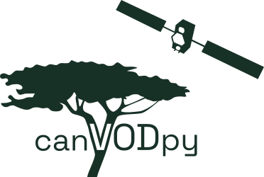

<h1 align="center">
  <picture>
    <source media="(prefers-color-scheme: dark)" srcset="docs/assets/logo/canvodpy_logo_dark_mode.svg">
    
  </picture>
</h1>

[](https://github.com/nfb2021/canvodpy/actions/workflows/test_platforms.yml)
[](https://github.com/nfb2021/canvodpy/actions/workflows/test_coverage.yml)
[](https://pypi.org/project/canvodpy/)
[](https://www.python.org/)
[%20|%20Windows-lightgrey)](https://github.com/nfb2021/canvodpy/actions/workflows/test_platforms.yml)
[](https://doi.org/10.5281/zenodo.18496233)
[](https://opensource.org/licenses/Apache-2.0)
[](https://fair-software.eu)
[](https://bestpractices.coreinfrastructure.org/projects/12329)
[](https://www.tuwien.at/en/mg/geo/climers)
[![VODnet](https://img.shields.io/badge/-VODnet-2d6a4f?labelColor=555555&logo=data:image/png;base64,iVBORw0KGgoAAAANSUhEUgAAAA4AAAAOCAYAAAAfSC3RAAAAAXNSR0IArs4c6QAAAHhlWElmTU0AKgAAAAgABAEaAAUAAAABAAAAPgEbAAUAAAABAAAARgEoAAMAAAABAAIAAIdpAAQAAAABAAAATgAAAAAAAABIAAAAAQAAAEgAAAABAAOgAQADAAAAAQABAACgAgAEAAAAAQAAAA6gAwAEAAAAAQAAAA4AAAAAjn8NzQAAAAlwSFlzAAALEwAACxMBAJqcGAAAAflJREFUKBWtUEtoE1EUPe+9SczHiam/aixtqi1E7aai4kK0CAVBDFZwrQs3xp2KIriYtiKuav3QRVxYKIjFVihWrCBIaaWioKidQBsxi3SwYmMmkxidYWaemYEEKUgRPHDhXu4575x3gf+NKfVD3UQ2u/Zv7wrLF8mPfV2ZH1ZCNIM7xUCAHHjyfN6wQ8mZo3vvE4Av57tzOjfd/WZpivfJSW5wkzvomnzFe2SFTyyU+iFJtCpk1eaRfOIw84TuRsN7kEkVMDzyEjPvUtga2YiDTRFM5+m+F8XYHMZuzDqaWlQf8yVMpmJ0/DUu9g6hVNQAy8au3W04NHAV85oFRulZS+LDkIjtWmcyHT6vQHYoXwrouTWKkv4LLOAHE4N4K6dxZ2AISl4DpawVDVrYcXSFZtTPGSV8IatjUVErJ+Cwbdstx3Vw8CG+pmQIHg+HUVlWo7aSp/qz9Kn3W5p5S/x4DJ8/lfGt4kAow7bmBpQ9fuQ3RUFtM4Uz61Qk/vijbpLbgtc61n05zjQ1hCvXHmB9fT3OnT8NOWfi+uxP0IJxE4S4jrXzxrffm1xlb75Aud/cEFmD9vYW6KaNUoUmCpS3BblUPNk45sR0UBM6Qzx2qd9LVnfqujGS+64puaX8olEuj4uMHHnc2dTrcFZGtCOMxv11KxP/kfEbTTzNcyb5ar0AAAAASUVORK5CYII=&logoColor=white)](https://www.gfz.de/en/section/remote-sensing-and-geoinformatics/projects/vodnet)

**An Open Python Ecosystem for GNSS-Transmissometry Canopy VOD Retrievals**

canVODpy aims to be the central community-driven software suite for
deriving canopy Vegetation Optical Depth (VOD) from the signal-to-noise
ratio of the same [GNSS](https://gssc.esa.int/navipedia/index.php/GNSS)
signal, received at the same time by one receiver below the canopy and one
with an unobstructed view of the sky.

> **Upgrading from 0.x?** Stores written with canVODpy 0.x must be migrated
> before a v1.0.0 run writes to them. See
> [Upgrading to v1.0.0](https://canvodpy.eu/guides/upgrading/) for the
> commands, the changed settings and what is deprecated.

## Try it

<a href="https://molab.marimo.io/github/nfb2021/canvodpy-demo/blob/main/03_convenience_speedrun.py"></a>

The speedrun notebook goes through the whole pipeline on real test data,
from receiver files to VOD, in your browser. **All 21 notebooks** are at
[canvodpy.eu/notebooks](https://canvodpy.eu/notebooks/), each with its
results and a link to open it in molab.

To run a notebook on your own machine instead, install
[uv](https://docs.astral.sh/uv/getting-started/installation/) and run:

```bash
uvx marimo edit --sandbox https://raw.githubusercontent.com/nfb2021/canvodpy-demo/main/03_convenience_speedrun.py
```

The notebooks download their test data on first use (about 350 MB).

## Install

```bash
uv add canvodpy
```

canVODpy requires Python 3.14. It is tested on Linux, macOS (Apple
silicon), and Windows.

## Quick start

Create the settings file, check it, and process a week:

```bash
canvodpy config init --interactive     # asks for your site and folders
canvodpy config validate --site MySite # lists what a run would process
canvodpy run --site MySite --start 2025001 --end 2025007
```

Days are given as `YYYYDDD` (year and day of year). The same from Python:

```python
from canvodpy import Site

site = Site("MySite")
with site.pipeline() as pipeline:
    for unit in pipeline.run("2025001", "2025007"):
        print(sorted(unit.days), unit.vod.written)
```

[Start here](https://canvodpy.eu/users/) walks through the first run step
by step.

## Packages

`canvodpy` installs all of them. Each can also be installed on its own.

| Package | What it does |
| --- | --- |
| `canvodpy` | The command line, the `Site` API and the processing pipeline |
| `canvod-readers` | Readers for RINEX, SBF, and NMEA files |
| `canvod-auxiliary` | Orbit and clock products, satellite angles |
| `canvod-store` | Icechunk stores for observations and VOD |
| `canvod-store-metadata` | Store metadata (DataCite, ACDD, STAC) and the STAC catalog |
| `canvod-vod` | VOD retrieval |
| `canvod-grids` | Hemispheric grids |
| `canvod-viz` | 2D and 3D plots |
| `canvod-ops` | Preprocessing: temporal aggregation, grid cell assignment |
| `canvod-config` | The settings file and its checks |
| `canvod-preflight` | The canVOD file name convention |
| `canvod-utils` | Shared utilities |

Optional extensions, such as `canvod-filemap` for file names that don't
follow the convention, are in
[canvodpy-extensions](https://github.com/nfb2021/canvodpy-extensions).

## Development

Development needs [uv](https://docs.astral.sh/uv/getting-started/installation/)
and [just](https://github.com/casey/just).

```bash
git clone --recurse-submodules https://github.com/nfb2021/canvodpy.git
cd canvodpy
just check-dev-tools   # checks that the tools are installed
uv sync
just hooks             # installs the pre-commit hooks
just test
just check             # lint, format, type check
```

`just --list` shows every command, sorted into groups. The
[contributor setup](https://canvodpy.eu/guides/contributor-setup/) has the
details.

## Documentation

All documentation is at **[canvodpy.eu](https://canvodpy.eu/)**:

- [Start here](https://canvodpy.eu/users/): from installation to the first VOD
- [Settings file](https://canvodpy.eu/guides/configuration/)
- [Command line and Python](https://canvodpy.eu/guides/api-levels/)
- [Your own readers and VOD calculators](https://canvodpy.eu/guides/plugins/)
- [Monorepo structure](https://canvodpy.eu/architecture/) and
  [developing with coding agents](https://canvodpy.eu/guides/ai-development/)

## Contributing

Contributions of all kinds are welcome. See [CONTRIBUTING.md](CONTRIBUTING.md).
First-time contributors: add yourself to [CONTRIBUTORS.md](CONTRIBUTORS.md)
in your pull request.

## How to cite

If you use canVODpy, please cite it with its DOI,
[`10.5281/zenodo.18496233`](https://doi.org/10.5281/zenodo.18496233). This
DOI always leads to the newest version, and Zenodo also lists a DOI for
each version. [CITATION.cff](CITATION.cff) has the full citation, and GitHub
shows it in the "Cite this repository" menu.

## License

Licensed under the [Apache License 2.0](LICENSE).

This software is provided "as is" without warranty of any kind. See the
[Impressum](https://canvodpy.eu/impressum/) for the full legal notice and
AI disclosure.

## Affiliation

[Climate and Environmental Remote Sensing Research Unit (CLIMERS)](https://www.tuwien.at/en/mg/geo/climers)
Department of Geodesy and Geoinformation, TU Wien

Contact: support@canvodpy.eu
