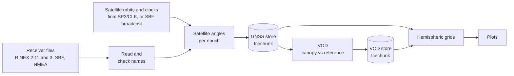

<!-- CI/CD & Quality -->
[](https://github.com/nfb2021/canvodpy/actions/workflows/test_platforms.yml)
[](https://github.com/nfb2021/canvodpy/actions/workflows/test_coverage.yml)
[](https://github.com/nfb2021/canvodpy/actions/workflows/fair-software.yml)

<!-- Python, Platforms & Package Manager -->
[](https://pypi.org/project/canvodpy/)
[](https://www.python.org/)
[%20|%20Windows-lightgrey)](https://github.com/nfb2021/canvodpy/actions/workflows/test_platforms.yml)
[](https://github.com/astral-sh/uv)

<!-- Identity -->
[](https://doi.org/10.5281/zenodo.18496233)
[](https://opensource.org/licenses/Apache-2.0)
[](https://www.tuwien.at/en/mg/geo/climers)
[![VODnet](https://img.shields.io/badge/-VODnet-2d6a4f?labelColor=555555&logo=data:image/png;base64,iVBORw0KGgoAAAANSUhEUgAAAA4AAAAOCAYAAAAfSC3RAAAAAXNSR0IArs4c6QAAAHhlWElmTU0AKgAAAAgABAEaAAUAAAABAAAAPgEbAAUAAAABAAAARgEoAAMAAAABAAIAAIdpAAQAAAABAAAATgAAAAAAAABIAAAAAQAAAEgAAAABAAOgAQADAAAAAQABAACgAgAEAAAAAQAAAA6gAwAEAAAAAQAAAA4AAAAAjn8NzQAAAAlwSFlzAAALEwAACxMBAJqcGAAAAflJREFUKBWtUEtoE1EUPe+9SczHiam/aixtqi1E7aai4kK0CAVBDFZwrQs3xp2KIriYtiKuav3QRVxYKIjFVihWrCBIaaWioKidQBsxi3SwYmMmkxidYWaemYEEKUgRPHDhXu4575x3gf+NKfVD3UQ2u/Zv7wrLF8mPfV2ZH1ZCNIM7xUCAHHjyfN6wQ8mZo3vvE4Av57tzOjfd/WZpivfJSW5wkzvomnzFe2SFTyyU+iFJtCpk1eaRfOIw84TuRsN7kEkVMDzyEjPvUtga2YiDTRFM5+m+F8XYHMZuzDqaWlQf8yVMpmJ0/DUu9g6hVNQAy8au3W04NHAV85oFRulZS+LDkIjtWmcyHT6vQHYoXwrouTWKkv4LLOAHE4N4K6dxZ2AISl4DpawVDVrYcXSFZtTPGSV8IatjUVErJ+Cwbdstx3Vw8CG+pmQIHg+HUVlWo7aSp/qz9Kn3W5p5S/x4DJ8/lfGt4kAow7bmBpQ9fuQ3RUFtM4Uz61Qk/vijbpLbgtc61n05zjQ1hCvXHmB9fT3OnT8NOWfi+uxP0IJxE4S4jrXzxrffm1xlb75Aud/cEFmD9vYW6KaNUoUmCpS3BblUPNk45sR0UBM6Qzx2qd9LVnfqujGS+64puaX8olEuj4uMHHnc2dTrcFZGtCOMxv11KxP/kfEbTTzNcyb5ar0AAAAASUVORK5CYII=&logoColor=white)](https://www.gfz.de/en/section/remote-sensing-and-geoinformatics/projects/vodnet)
<!-- [![VODnet](https://img.shields.io/badge/VODnet-GNSS--T%20network-2d6a4f?logo=data:image/png;base64,iVBORw0KGgoAAAANSUhEUgAAAA4AAAAOCAYAAAAfSC3RAAAAAXNSR0IArs4c6QAAAHhlWElmTU0AKgAAAAgABAEaAAUAAAABAAAAPgEbAAUAAAABAAAARgEoAAMAAAABAAIAAIdpAAQAAAABAAAATgAAAAAAAABIAAAAAQAAAEgAAAABAAOgAQADAAAAAQABAACgAgAEAAAAAQAAAA6gAwAEAAAAAQAAAA4AAAAAjn8NzQAAAAlwSFlzAAALEwAACxMBAJqcGAAAAflJREFUKBWtUEtoE1EUPe+9SczHiam/aixtqi1E7aai4kK0CAVBDFZwrQs3xp2KIriYtiKuav3QRVxYKIjFVihWrCBIaaWioKidQBsxi3SwYmMmkxidYWaemYEEKUgRPHDhXu4575x3gf+NKfVD3UQ2u/Zv7wrLF8mPfV2ZH1ZCNIM7xUCAHHjyfN6wQ8mZo3vvE4Av57tzOjfd/WZpivfJSW5wkzvomnzFe2SFTyyU+iFJtCpk1eaRfOIw84TuRsN7kEkVMDzyEjPvUtga2YiDTRFM5+m+F8XYHMZuzDqaWlQf8yVMpmJ0/DUu9g6hVNQAy8au3W04NHAV85oFRulZS+LDkIjtWmcyHT6vQHYoXwrouTWKkv4LLOAHE4N4K6dxZ2AISl4DpawVDVrYcXSFZtTPGSV8IatjUVErJ+Cwbdstx3Vw8CG+pmQIHg+HUVlWo7aSp/qz9Kn3W5p5S/x4DJ8/lfGt4kAow7bmBpQ9fuQ3RUFtM4Uz61Qk/vijbpLbgtc61n05zjQ1hCvXHmB9fT3OnT8NOWfi+uxP0IJxE4S4jrXzxrffm1xlb75Aud/cEFmD9vYW6KaNUoUmCpS3BblUPNk45sR0UBM6Qzx2qd9LVnfqujGS+64puaX8olEuj4uMHHnc2dTrcFZGtCOMxv11KxP/kfEbTTzNcyb5ar0AAAAASUVORK5CYII=&logoColor=white)](https://www.gfz.de/en/section/remote-sensing-and-geoinformatics/projects/vodnet) -->

<!-- Trust & FAIR -->
[](https://fair-software.eu)
[](https://bestpractices.coreinfrastructure.org/projects/12329)
[](https://securityscorecards.dev/viewer/?uri=github.com/nfb2021/canvodpy)


<h1 align="center">
  <picture>
    <source media="(prefers-color-scheme: dark)" srcset="docs/assets/logo/canvodpy_logo_dark_mode.svg">
    
  </picture>
</h1>

An open Python ecosystem for GNSS-Transmissometry (GNSS-T) canopy VOD retrievals. canVODpy is a community-driven software suite for deriving and analyzing Vegetation Optical Depth from GNSS signal-to-noise ratio observations.

<p align="center">
  <a href="https://molab.marimo.io/github/nfb2021/canvodpy-demo/blob/main/03_convenience_speedrun.py"></a>
</p>
<p align="center">
  <b>See canVODpy at work:</b> the speedrun notebook goes through the whole pipeline on real test data, from receiver files to VOD.<br>
  Open it in molab, or read it with its results on <a href="https://canvodpy.eu/notebooks/_build/03_convenience_speedrun.html">canvodpy.eu</a>. All notebooks: <a href="https://canvodpy.eu/notebooks/">canvodpy.eu/notebooks</a>
</p>

| Toolchain                                                                                                                                                                                                                                                                                                                                                                                                                            | Scientific Stack                                                                                                                                                                                                                                                                                                                                                | Standards                                                                                                                                                                                                                           | Notebooks                                                                                  | AI                                                                                                                                           |
| ------------------------------------------------------------------------------------------------------------------------------------------------------------------------------------------------------------------------------------------------------------------------------------------------------------------------------------------------------------------------------------------------------------------------------------ | --------------------------------------------------------------------------------------------------------------------------------------------------------------------------------------------------------------------------------------------------------------------------------------------------------------------------------------------------------------- | ----------------------------------------------------------------------------------------------------------------------------------------------------------------------------------------------------------------------------------- | ------------------------------------------------------------------------------------------ | -------------------------------------------------------------------------------------------------------------------------------------------- |
| [](https://github.com/astral-sh/ruff) [](https://github.com/astral-sh/ty)[](https://github.com/casey/just) | [](https://xarray.dev/) [](https://www.dask.org/) [](https://pola.rs/)                                          | [](https://schema.datacite.org/) [](https://wiki.esipfed.org/Attribute_Convention_for_Data_Discovery_1-3) | [](https://canvodpy.eu/notebooks/) | [](https://claude.com/claude-code) |
| [](https://conventionalcommits.org)                                                                                                                                                                                                                                                             | [](https://docs.pydantic.dev/) [](https://icechunk.io/) | [](https://stacspec.org/) [](https://reuse.software/)                                                                 |                                                                                            |                                                                                                                                              |

---

## Try it

Every demo notebook runs on real test data, which it downloads on first
use (about 350 MB, about 1 GB unpacked; later runs reuse it).

**In the browser:** open a notebook in molab with the badge above, or read
the notebooks with their results at
[canvodpy.eu/notebooks](https://canvodpy.eu/notebooks/).

**On your own machine:** install [uv](https://docs.astral.sh/uv/getting-started/installation/),
then run one notebook straight from GitHub:

```bash
uvx marimo edit --sandbox https://raw.githubusercontent.com/nfb2021/canvodpy-demo/main/03_convenience_speedrun.py
```

`--sandbox` installs the packages the notebook declares into a throwaway
environment, so nothing else on your machine changes. You don't need to
clone anything. The [canvodpy-demo README](https://github.com/nfb2021/canvodpy-demo#readme)
lists all 21 notebooks and other ways to run them.

## What canVODpy does



- **Reads** the observation files of your receivers: RINEX 2.11 and 3,
  Septentrio binary (SBF) and NMEA. Your own readers can be added as
  plugins.
- **Computes the satellite angles** of every observation, from agency final
  orbit and clock products (SP3/CLK) or from the broadcast ephemerides in
  SBF files.
- **Stores** the observations of each site in a versioned
  [Icechunk](https://icechunk.io/) store. Every commit keeps a snapshot, a
  log book records which file produced which data, and each store carries
  DataCite, ACDD and STAC metadata.
- **Retrieves VOD** from a canopy and a reference receiver with the
  tau-omega model and writes it to a VOD store. Your own VOD calculators
  can be added as plugins.
- **Assigns observations to hemispheric grids** (equal-area, equal-angle,
  HTM, geodesic, HEALPix, Fibonacci and more) and plots them in 2D and 3D.

## Install

```bash
uv add canvodpy
# or
pip install canvodpy
```

canVODpy requires Python 3.14. It is tested on Linux, macOS (Apple
silicon) and Windows.

## Quick start

Create the settings file, check it, and process a week:

```bash
canvodpy config init --interactive     # asks for your site and folders
canvodpy config validate --site MySite # lists what a run would process
canvodpy run --site MySite --start 2025001 --end 2025007
```

Days are given as `YYYYDDD` (year and day of year). Without `--start`, a run
resumes from the last day in the store.

The same from Python, for scripts and notebooks:

```python
from canvodpy import Site

site = Site("MySite")

with site.pipeline() as pipeline:
    for date_key, datasets in pipeline.process_range("2025001", "2025007"):
        site.vod.compute_day(datasets, "canopy_01_vs_reference_01")
```

[Start here](https://canvodpy.eu/users/) walks through the first run step
by step.

## Documentation

All documentation is at **[canvodpy.eu](https://canvodpy.eu/)**:

- [Start here](https://canvodpy.eu/users/): from installation to the first VOD
- [Settings file](https://canvodpy.eu/guides/configuration/)
- [Command line and Python](https://canvodpy.eu/guides/api-levels/)
- [Your own readers and VOD calculators](https://canvodpy.eu/guides/plugins/)
- [Monorepo structure](https://canvodpy.eu/architecture/) and
  [package dependencies](https://canvodpy.eu/dependencies/)

## Packages

`canvodpy` installs all of them. Each can also be installed on its own.

| Package | What it does |
| --- | --- |
| `canvodpy` | The command line, the `Site` API and the processing pipeline |
| `canvod-readers` | Readers for RINEX, SBF and NMEA files |
| `canvod-auxiliary` | Orbit and clock products, satellite angles |
| `canvod-store` | Icechunk stores for observations and VOD |
| `canvod-store-metadata` | Store metadata (DataCite, ACDD, STAC) and the STAC catalog |
| `canvod-vod` | VOD retrieval |
| `canvod-grids` | Hemispheric grids |
| `canvod-viz` | 2D and 3D plots |
| `canvod-ops` | Preprocessing: temporal aggregation, grid cell assignment |
| `canvod-config` | The settings file and its checks |
| `canvod-preflight` | The canVOD file name convention |
| `canvod-utils` | Shared utilities |

Optional extensions, such as `canvod-filemap` for file names that don't
follow the convention, are in
[canvodpy-extensions](https://github.com/nfb2021/canvodpy-extensions).

## Development

Development needs [uv](https://docs.astral.sh/uv/getting-started/installation/)
and [just](https://github.com/casey/just).

```bash
git clone --recurse-submodules https://github.com/nfb2021/canvodpy.git
cd canvodpy
just check-dev-tools   # checks that the tools are installed
uv sync
just hooks             # installs the pre-commit hooks
just test
just check             # lint, format, type check
```

`just --list` shows every command. The
[contributor setup](https://canvodpy.eu/guides/contributor-setup/) has the
details.

| Repository | Purpose |
| --- | --- |
| [canvodpy-demo](https://github.com/nfb2021/canvodpy-demo) | The marimo demo notebooks; submodule at `demo/` |
| [canvodpy-test-data](https://github.com/nfb2021/canvodpy-test-data) | The receiver files the tests use; submodule at `packages/canvod-readers/tests/test_data/` |
| [canvodpy-extensions](https://github.com/nfb2021/canvodpy-extensions) | Optional extensions, released on GitHub only |

canVODpy is developed with coding agents, mostly
[Claude Code](https://claude.com/claude-code). The repository carries their
instructions (`AGENTS.md`, `CODING_STANDARDS.md`, `GLOSSARY.md`, the
decision records in `docs/adr/`), which are also a short guide to the
project's rules for people. See
[Developing with coding agents](https://canvodpy.eu/guides/ai-development/).

## Contributing

Contributions of all kinds are welcome. See [CONTRIBUTING.md](CONTRIBUTING.md).
First-time contributors: add yourself to [CONTRIBUTORS.md](CONTRIBUTORS.md)
in your pull request.

## License

Licensed under the [Apache License 2.0](LICENSE).

This software is provided "as is" without warranty of any kind. See the
[Impressum](https://canvodpy.eu/impressum/) for the full legal notice and
AI disclosure.

## Affiliation

Founded by **Nicolas François Bader**

[Climate and Environmental Remote Sensing Research Unit (CLIMERS)](https://www.tuwien.at/en/mg/geo/climers)
Department of Geodesy and Geoinformation, TU Wien

Email: support@canvodpy.eu
