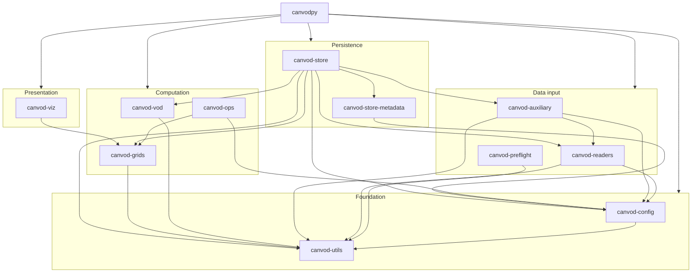
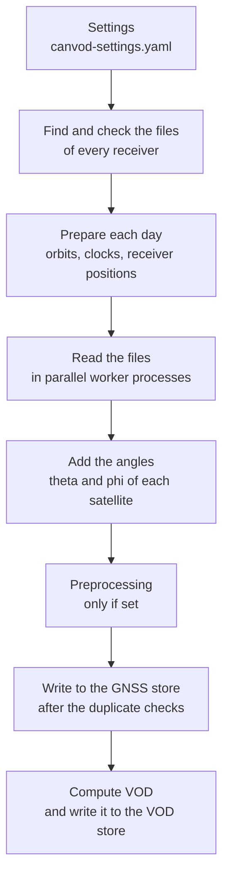

# Architecture

This page describes how canVODpy is built: the packages, the layers they
form, and the path your files take through a processing run.
[Design principles](principles.md) explains the rules behind these
choices.

---

## Packages and layers

canVODpy consists of eleven packages and the `canvodpy` package, which
brings them together. Each package has its own `pyproject.toml` and can
be installed on its own. The packages form six layers, and a package
depends only on packages in its own layer or in the layers below it.

| Layer | Packages | What they do |
|---|---|---|
| Orchestration | `canvodpy` | The `canvodpy` command, `Site` and `Site.pipeline()`, the processing run, VOD computation for a site (`VodComputer`), and the tasks for Airflow |
| Presentation | `canvod-viz` | Hemisphere plots in 2D and 3D |
| Persistence | `canvod-store`, `canvod-store-metadata` | The Icechunk stores and their log books; the description of a store, with the metadata of the DataCite, ACDD, and STAC conventions |
| Computation | `canvod-vod`, `canvod-grids`, `canvod-ops` | VOD retrieval, hemisphere grids and the assignment of observations to their cells, and the optional preprocessing |
| Data input | `canvod-readers`, `canvod-auxiliary`, `canvod-preflight` | Readers for RINEX 2 and 3, SBF, and NMEA; orbits and clocks, and the angles of each satellite seen from the receiver; the canonical filename convention |
| Foundation | `canvod-config`, `canvod-utils` | The settings and how they're loaded; dates, file hashes, the deprecation decorators, the plugin loader, and the run identifier |

The arrows point from a package to the packages it declares as
dependencies. `canvodpy` depends on all eleven.



[Package dependencies](dependencies.md) lists the same dependencies with
a few numbers on how independent each package is. Optional packages, for
example the Airflow integration, live in a separate repository; see
[Optional extensions](guides/extensions.md).

---

## One repository, many packages

All packages live in one repository, under `packages/`, and share the
namespace `canvod`:

```python
from canvod.readers import Rnxv3Obs
from canvod.grids import create_hemigrid
from canvod.vod import TauOmegaZerothOrder
from canvod.store import create_gnss_store
```

[Namespace packages](namespace-packages.md) explains how separate
packages share one namespace.

The repository is a uv workspace. One `uv sync` installs every package in
editable mode, from one lock file, so all packages are developed and tested
against the same versions of their dependencies. Each package is
published to PyPI on its own, all of them except `canvod-preflight` so
far, so you can install only the parts you need:

```bash
uv add canvod-readers   # the readers only
uv add canvodpy         # everything
```

---

## What a run does

`canvodpy run`, `Site.pipeline()`, and the Airflow task `process_day` all
run the same code. A run goes through these steps.



1. **Read the settings.** `canvod-settings.yaml` is checked against the
   settings models of `canvod-config`. An unknown key or a wrong value
   stops the run with a message that names it. See
   [Configuration](guides/configuration.md).
2. **Find and check the files.** The run finds the files of every
   receiver in any folder layout. It recognizes them by their canonical
   names or through a naming recipe. It stops before it reads anything if two files have the
   same canonical name, if files overlap in time, or if one folder holds
   the files of more than one receiver. The reader comes from
   `reader_format` in the settings of the receiver, or is detected from the
   files.
3. **Prepare each day.** For each day, the run gets the satellite orbits
   (SP3) and, unless `aux_data.fetch_clock` is `false`, the satellite
   clocks (CLK), and interpolates them onto the epochs of the day: orbits
   with cubic Hermite splines, clocks piecewise linearly. Without a NASA
   Earthdata account in the settings, the files come from ESA; with one,
   from NASA CDDIS first and from ESA if that fails. For SBF files, the
   setting `ephemeris_source: broadcast` uses the satellite angles that the
   receiver recorded in the files instead, and skips the download.
4. **Read the files.** Each file becomes an `xarray.Dataset` with the
   dimensions `epoch` and `sid`. The files of a batch of days are read in
   parallel, one task per file.
5. **Add the angles.** From the satellite positions and the receiver
   position, the run computes the polar angle `theta` and the azimuth
   `phi` of each observation.
6. **Preprocessing.** Only if `processing.preprocessing` is set: temporal
   aggregation and assignment of each observation to its grid cell. The
   stores' log books record the preprocessing, and a store group never
   mixes data that was preprocessed differently. See
   [`canvod-ops`](packages/ops/overview.md).
7. **Write to the GNSS store.** The run checks each file against the store
   and against the other files of the batch, and then writes what is new.
   See [Design principles](principles.md#the-same-data-is-never-written-twice-by-default).
8. **Compute VOD.** For each VOD analysis in the settings, `VodComputer`
   reads the canopy and the reference receiver from the GNSS store, keeps
   the epochs and signals both have, and computes VOD with the selected
   calculator. The zeroth-order tau-omega calculator computes the
   transmissivity `T` from the difference of the two SNR values in
   decibels, and `VOD = -ln(T) cos(theta)`. The result goes to the VOD
   store, which checks it before it writes. See
   [`canvod-vod`](packages/vod/overview.md).

---

## Parallel work

- **Preparing.** Each day of a batch of days (`days_per_batch`) is
  prepared in its own thread.
- **Reading.** The files are read in a pool of worker processes
  ([loky](https://github.com/joblib/loky)), which stays up from one batch
  to the next. `--workers`, or the resource settings, set the number of
  workers.
- **Writing.** Only one process writes. As soon as all files of a receiver
  and day are read, it writes them with one commit for the data and its
  log-book rows. With the `overwrite` strategy, it writes on a temporary
  branch first and then moves `main` to it. On a local or network file
  system, Icechunk can't detect two commits at the same time, so one
  writer is what keeps the store and its duplicate checks consistent.
- **VOD.** After a batch is written, the run computes the VOD day by day
  and writes all analyses of a day with one commit, before the next batch
  starts.

See [Parallel processing](guides/parallel-processing.md) for the settings.

---

## Entry points

| Entry point | Use it to |
|---|---|
| `canvodpy run --site ...` | Process a period from the command line |
| `Site(name).pipeline()` | Process a period from Python, with the same code |
| `canvodpy.workflows.tasks` (`check_day`, `process_day`) | Run single days from a scheduler such as Airflow |

[Command line and Python](guides/api-levels.md) lists the options.

---

**Next:** [Design principles](principles.md) ·
[Package dependencies](dependencies.md) ·
[Contributor setup](guides/contributor-setup.md)
