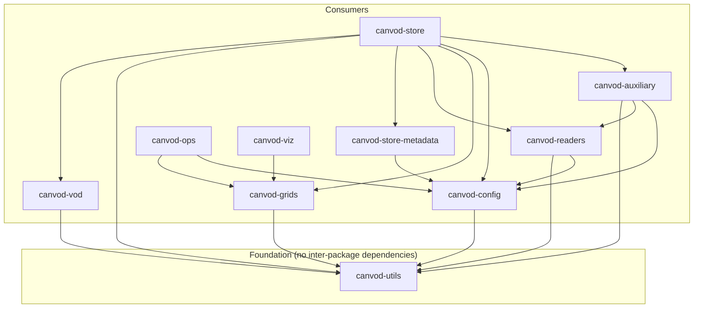

# Package Dependencies

Inter-package dependency relationships and independence metrics for the canVODpy monorepo.

---

## Dependency Graph

This covers the 10 packages `canvodpy` itself directly depends on (verified
against each package's `pyproject.toml`). `canvod-preflight` is a separate
monorepo package `canvodpy` doesn't depend on directly, so it's out of scope
here — see [Architecture](architecture.md) for the full eleven-package
picture.



The graph has no cycle: every package depends only on packages above it
in this order: utils; config, vod, grids; readers, store-metadata;
auxiliary; store; ops, viz. `canvod-store` depends on `canvod-grids` to
store grids and the analysis results computed on them (`store_grid`,
`load_grid`, `AnalysisStorage`); `canvod-grids` doesn't import
`canvod-store`.

`just check-package-imports` installs each package with only its declared
dependencies and imports every module, so a dependency a package uses but
does not declare fails in CI.

---

## Independence Metrics

| Package | Ce (deps) | Ca (dependents) | Instability | Independence |
|---------|:---------:|:---------------:|:-----------:|:------------:|
| canvod-utils | 0 | 6 | 0.00 | 1.00 |
| canvod-config | 1 | 5 | 0.17 | 0.90 |
| canvod-grids | 1 | 3 | 0.25 | 0.90 |
| canvod-store-metadata | 1 | 1 | 0.50 | 0.90 |
| canvod-vod | 1 | 1 | 0.50 | 0.90 |
| canvod-viz | 1 | 0 | 1.00 | 0.90 |
| canvod-readers | 2 | 2 | 0.50 | 0.80 |
| canvod-ops | 2 | 0 | 1.00 | 0.80 |
| canvod-auxiliary | 3 | 1 | 0.75 | 0.70 |
| canvod-store | 7 | 0 | 1.00 | 0.30 |

??? note "Metric definitions"
    - **Ce (efferent coupling)** — packages this package depends on. Lower = more independent.
    - **Ca (afferent coupling)** — packages that depend on this one. Higher = more reusable.
    - **Instability** — `Ce / (Ce + Ca)`. 0.0 = maximally stable (foundation). 1.0 = maximally unstable (leaf).
    - **Independence** — `1 − (Ce / total_packages)`. 1.0 = no inter-package dependencies.

---

## Architecture Summary

- No circular dependencies.
- `canvod-utils` is the only package without inter-package dependencies.
- 21 internal dependency edges.
- `canvod-utils` and `canvod-config` are the most depended-on packages
  (Ca = 6 and 5): changes there have the widest blast radius.

---

## Extractability

Each package can be extracted to its own repository once the packages it
depends on are on PyPI:

=== "Foundation"

    ```bash
    packages/canvod-utils/           → independent repo
    ```

=== "Consumers"

    ```bash
    packages/canvod-config/          → independent repo (+ canvod-utils)
    packages/canvod-vod/             → independent repo (+ canvod-utils)
    packages/canvod-grids/           → independent repo (+ canvod-utils)
    packages/canvod-readers/         → independent repo (+ canvod-config, canvod-utils)
    packages/canvod-store-metadata/  → independent repo (+ canvod-config)
    packages/canvod-auxiliary/       → independent repo (+ canvod-config, canvod-readers, canvod-utils)
    packages/canvod-store/           → independent repo (+ canvod-auxiliary, canvod-config, canvod-grids,
                                         canvod-readers, canvod-store-metadata, canvod-utils, canvod-vod)
    packages/canvod-ops/             → independent repo (+ canvod-config, canvod-grids)
    packages/canvod-viz/             → independent repo (+ canvod-grids)
    ```

---

## Regenerate Reports

!!! warning "Currently broken"
    `scripts/analyze_dependencies.py` and `scripts/generate_all_graphs.py`,
    which this page's numbers were originally generated from, no longer exist
    in `scripts/`. The commands below are Justfile recipes that reference
    them — they will fail until the scripts are restored. Until then, this
    page was corrected by hand against each package's `pyproject.toml`.

```bash
just deps-report    # Full metrics report (broken — see above)
just deps-mermaid   # Mermaid dependency diagram (broken — see above)
```
