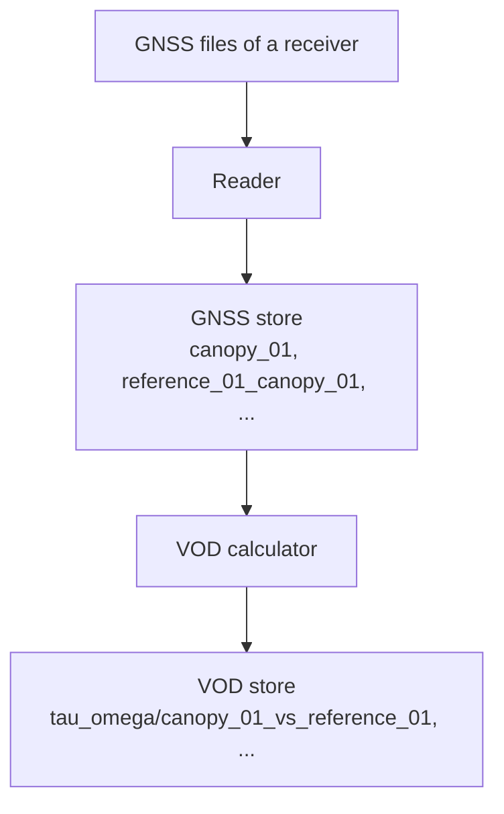

# canvod-store

`canvod-store` keeps the data of a site in two
[Icechunk](https://icechunk.io/) stores: the **GNSS store** holds the
observations of every receiver, and the **VOD store** holds the VOD
results. Icechunk stores Zarr arrays and records every write as a commit,
so earlier states of a store stay readable.

This page describes what the stores hold, how a run writes to them, and how
to read them in your own code.

## The two stores of a site

Each site has its own GNSS store and VOD store, both under
`processing.storage.stores_root_dir`:

```text
<stores_root_dir>/
└── ExampleSite/
    ├── rinex/   # GNSS store (processing.storage.gnss_store_name)
    └── vod/     # VOD store (processing.storage.vod_store_name)
```

The GNSS store holds data from every reader format (RINEX, SBF, and NMEA),
although its default directory name is `rinex`.

A store knows its site from its own metadata, not from the folder it
sits in: `store.site_name` stays the same when the folder is moved or
renamed. A store written before stores kept repository metadata has no
site name; reading it raises an error that names
`canvodpy store migrate-metadata`.



## Groups

A store holds one group per receiver, or per VOD analysis.

In the GNSS store:

- A canopy receiver has one group, named after the receiver, for example
  `canopy_01`.
- A reference receiver has one group per canopy receiver it is paired with,
  named `{reference}_{canopy}`, for example `reference_01_canopy_01`.

In the VOD store, a group is named `{calculator}/{analysis}`, for example
`tau_omega/canopy_01_vs_reference_01`.

The data variables of a GNSS store group (for example `SNR`, `Phase`,
`Pseudorange`, and `Doppler`, depending on the reader) have the dimensions
`epoch` and `sid` and sit directly in the group:

```text
canopy_01/
├── SNR
├── Phase
├── ...
└── metadata/
    ├── table     # log book: one row per stored file
    └── sbf_obs   # SBF receivers only: receiver metadata per file
```

The log book (`metadata/table`) records each stored file: its hash, start,
end, filename, the dataset attributes, and the preprocessing record (see
[Preprocessing during a run](../ops/overview.md#the-preprocessing-record)).
In a group made of day blocks, it also records how many epochs of the file
were stored (`epochs`). Every other value in it is text, JSON, or a time.

## Day blocks

A new GNSS store is written as day blocks
([ADR 0016](../../adr/0016-day-blocks-and-forked-writes.md)). The `epoch`
axis of a group holds one block per day, with one slot for every epoch of
the day at the day's cadence: 17280 slots for a day at 5 s, 86400 at 1 s.
Blocks are stored in the order the days were first processed; reading a
group returns its epochs in time order.

A run adds the blocks of a batch of days (`days_per_batch`) in one small
commit, after it has prepared the days and before it reads any file. Only
days whose orbit and clock products are ready get a block; the cadence
comes from the filenames, so the run reads no file for this. If the files of a
day then fail, its block stays empty and the next run of that day uses
it. A group's first write creates the group and its first blocks. If
another run added blocks to the store in the meantime, the run reads the
store again, uses the blocks already there, and adds the rest.

- Each epoch of a file goes into its nearest slot: 00:00 of the day plus a
  multiple of the cadence. The `epoch` coordinate keeps the epoch's real
  time.
- A slot without data holds its grid time in `epoch`, NaN in
  floating-point variables, and -1 in integer variables such as `LLI` and
  `SSI` (their `_FillValue`).
- Writing a file again writes the same slots, so it never adds epochs.
- The cadence of a day is the finest sampling interval in the names of the
  files of the day, or the bin length of
  `processing.preprocessing.temporal_aggregation` when it is set. A day
  holds a whole number of chunks of 180 epochs
  (`processing.icechunk.chunk_strategies.gnss_store.epoch`), so the cadence
  must divide 86400 s / 180 = 480 s: 1 s, 5 s, 15 s, 30 s, or 1 min, for
  example. Days in one group can have different cadences. A group keeps
  the chunk size it was created with: a changed setting applies to new
  groups only (see [Chunks](chunks.md)).
- A group records its layout in its attributes (`epoch_layout:
  day_blocks`). A store whose groups were written by appending files to
  the `epoch` axis, by canVODpy versions before day blocks, is still
  written that way.

`GnssResearchSite.read_receiver_data()` returns only the slots with data.
`MyIcechunkStore.read_group()` returns every slot; with `drop_empty=True`
it leaves out the empty ones (slots where every floating-point variable is
missing).

## How a run writes

`canvodpy run` writes to both stores; in your own code, read from them.

On a file system, Icechunk can't detect two commits at the same time: both
can report success while Icechunk loses one of them
([Icechunk: storage](https://icechunk.io/en/stable/guides/storage/)). So
every commit to a store first takes the store's commit lock, the file
`.canvodpy-commit.lock` in the store directory. A commit from another
thread or process, for example a second run or a scheduler task, waits
until the lock is free. Write a store from one computer only.

Two Icechunk warnings don't apply to these stores, so canVODpy hides them:
that the file system is not safe for concurrent commits (the commit lock
covers this), and that a lost reply to a write may show up as a conflict
(Icechunk's file system storage makes one try per write and keeps no
write metadata). Every other Icechunk warning is shown. To set your own
filter, set the environment variable `ICECHUNK_LOG`, for example
`ICECHUNK_LOG=icechunk=debug`.

For each receiver and day, a run does the following:

1. Reads the files and computes the satellite angles.
1. Applies the preprocessing in `processing.preprocessing`, if set.
1. Checks each file against the group's log book (see
   [Duplicate checks](#duplicate-checks)).
1. Writes the new data with one commit. In a store made of day blocks,
   the worker processes write the files into their slots and one commit
   writes the day of all receivers; otherwise each receiver and day gets
   its own commit. The same commit writes the snapshot summary and
   records the commit metadata (see
   [canvod-store-metadata](../store-metadata/overview.md)).

A write must match the group. A run stops with an error if:

- the data has other variables than the group
  (`GroupVariablesMismatchError`);
- the data has other `sid` labels than the group
  (`GroupCoordinatesMismatchError`). The labels are stored once per group,
  so an append with other labels, for example after you change
  `processing.params.aggregate_glonass_fdma`, would relabel the stored
  data;
- the epochs aren't in GPS time, or the group doesn't record its time
  scale (`EpochTimeSystemError`). Every stored epoch is GPS time
  (`epoch.attrs["time_system"] == "GPS"`). Groups written by canVODpy
  before it stored every epoch in GPS time have no record (their SBF and
  NMEA epochs were UTC, 18 s earlier); write to a new store;
- the cadence of a day block doesn't divide 480 s, or a day stored at a
  coarser cadence gets a file sampled more often (`CadenceError`);
- a file would be appended to a group made of day blocks (`LayoutError`).

A file with two epochs in one slot, for example because its name gives a
coarser sampling than its data, isn't stored: the run logs a
`SlotCollisionError` and writes no log-book row for the file, so the next
run tries it again.

If another commit lands while a write is in progress, canVODpy rebases the
write onto it when the two changed different groups. If both changed the
same data, the later commit fails with `icechunk.RebaseFailedError` and
writes nothing. In a store made of day blocks, the run then writes the
day again on top of the other commit, up to five tries in all, with a
growing wait in between. When the last try fails too,
the run records the receivers and days as failed in its run history,
with the error, and goes on with the next days. It does the same when
it can't add the blocks of a batch.

## Duplicate checks

Before a run writes a file, it checks the file against the group's log
book, in three ways:

| Check | What it finds | Where |
|---|---|---|
| Hash | The same file, already stored (SHA-256 of the file) | The orchestrator, and again in `append_to_group()` |
| Time span | A file whose time span overlaps stored data, also when it has another name or other start and end times | The orchestrator, and again in `append_to_group()` |
| Batch | Two files of one batch that cover the same time | The orchestrator |

A file that fails a check counts as already stored. The default write
strategy, `skip`, doesn't write it; `overwrite` replaces its time range.
For details, see [Write strategies](storage-strategies.md).

## Read a store

Open the stores of a configured site with `Site`:

```python
from canvodpy import Site

site = Site("ExampleSite")
site.gnss_store.list_groups()  # ["canopy_01", "reference_01_canopy_01"]
site.gnss_store.get_group_info("canopy_01")

ds = site.gnss_store.read_group("canopy_01")
ds_day = site.gnss_store.read_group("canopy_01", date="2025001")
ds_range = site.gnss_store.read_group(
    "canopy_01", time_slice=slice("2025-01-01", "2025-01-15")
)
```

`read_group()` returns an `xarray.Dataset` that reads its data only when a
value is needed, its epochs in time order. `date="2025001"` selects that
day only: from 00:00 up to, not including, 00:00 of the next day. A
`time_slice` includes both of its ends, and an end written as a date
(`"2025-01-15"`) means the whole of that day. For how reads load chunks,
see [Chunks](chunks.md); for earlier states of a store, see
[Versioning with Icechunk](icechunk.md).

To open a store by its path, use `open_gnss_store()` or
`open_vod_store()`:

```python
from canvod.store import open_gnss_store

store = open_gnss_store("/data/stores/ExampleSite/rinex")
```

Opening a store never creates one: a path without a store raises a
`FileNotFoundError` that names the path. A run creates a site's stores
when it first writes data, together with their metadata (see
[canvod-store-metadata](../store-metadata/overview.md)). `Site` opens its
stores only when you first use them, so a new site has no stores until a
run writes to it. `create_gnss_store()` and `create_vod_store()` are left
over from development: they open a store as well, and are removed with
the next major version.

## Compare two stores

`compare_stores()` compares two stores and returns a report of every
difference, per group and variable. It works on any two stores, for
example the reference stores of the test data and the stores a change
produces (spec #318), or a production store before and after an
upgrade. It only reads, through `MyIcechunkStore` (`list_groups` and
`read_group`), and never changes how a store is written or read.

Open each store by its path, then compare:

```python
from canvod.store import compare_stores, open_gnss_store

reference = open_gnss_store("/data/stores/ExampleSite/rinex")
new = open_gnss_store("/data/stores/ExampleSite-new/rinex")
report = compare_stores(reference, new)

report.matches  # True when the stores are the same
print(report.to_text())  # a report for a person
report.model_dump_json()  # a report for CI
```

The report lists a group present in one store and not the other, a lost
epoch or a renamed SID, a changed integer or flag variable, a value
present in one store and missing in the other, and a changed attribute
from the compared list: the `units` of every variable and coordinate,
the `time_system` of `epoch`, and the store's `source_format`. It
ignores what changes every run: software versions, timestamps, run ids,
paths, hashes, and the log book.

Float variables are compared within one absolute tolerance per
variable, derived from the finest resolution any format records. A
float variable not in the table is compared exactly and is reported as
`no tolerance set`, so a new variable is noticed.

| Variable | Tolerance | Derivation |
|---|---|---|
| `SNR` (also 1-minute means), `Pseudorange`, `Phase`, `Doppler` | 5e-4 | half the RINEX observation resolution, format F14.3 = 0.001 (RINEX 3.04, observation record, p. 67; RINEX 2.11, observation record). SBF (0.25 dB-Hz) and NMEA GSV (1 dB-Hz) are coarser. |
| `delta_snr` | 1e-3 | a difference of two SNR values, 2 × 5e-4 |
| `VOD` | 2e-4 | `VOD = -(ln 10 / 10) · delta_snr · cos(theta)`; `(ln 10 / 10) × 1e-3 = 2.3e-4`, rounded down |
| `theta`, `phi` | 1e-6 rad | `dVOD/dtheta = (ln 10 / 10) · delta_snr · sin(theta)`, at most 4.6 for `delta_snr` up to 20 dB, so 1e-6 rad moves VOD by at most 4.6e-6; above the float32 spacing at pi/2 (1.2e-7 rad) |

The tolerances, with their derivation and sources, are one constant in
the code: `FLOAT_TOLERANCES` in
`packages/canvod-store/src/canvod/store/comparison.py` (spec #318).

The JSON form carries `matches`, so a CI check can read the result.

## History

Each store keeps its commits and the operations on it:

```python
store = site.gnss_store

store.print_history(limit=20)  # commits on main, newest first
store.plot_commit_graph()  # commit graph: SVG in a notebook, text in a terminal
store.print_ops_log(limit=30)  # commits, branch operations, expiry, garbage collection

store.create_release_tag("v1.0")  # tag the latest commit on main
store.list_tags()
store.compare_snapshots(snapshot_id_1, snapshot_id_2)
```

## Command line

`canvodpy store` shows the stores of a configured site:

```bash
canvodpy store list                                 # GNSS and VOD store paths of every site
canvodpy store info ExampleSite                     # branches, groups, and statistics
canvodpy store info ExampleSite --group canopy_01   # the dataset and log book of one group
canvodpy store log ExampleSite                      # commit graph
canvodpy store log ExampleSite --ops                # operations on the store
canvodpy store maintain ExampleSite                 # what expiry and garbage collection would delete
```

`--store vod` opens the VOD store instead of the GNSS store, and `--branch`
selects a branch other than `main`. For every option, see the
[command-line reference](../../api/cli.md).

## Grids and analysis results

`store_grid()` writes a hemispherical grid to the `grids/{grid_name}` group
of a store, and `load_grid()` reads it back. A grid read back works for
cell assignment only if it's an equal-area, equal-angle, or equirectangular
grid; for the other grid types, build the grid again with
`create_hemigrid()`.

```python
from canvod.grids import create_hemigrid
from canvod.store import load_grid, store_grid

grid = create_hemigrid("equal_area", angular_resolution=4.0)
store_grid(grid, store, "equal_area_4deg")
grid = load_grid(store, "equal_area_4deg")
```

`AnalysisStorage` stores the results of an analysis on a grid in a VOD
store: weights, masks, statistics, and time series per cell. The time
series per cell go to the `per_cell` branch, one dataset per system, band,
and code:

```python
from canvod.store import AnalysisStorage

storage = AnalysisStorage("/path/to/vod_store")
storage.store_percell_timeseries(percell_ds, system="G", band="L1", code="C")
storage.list_percell_datasets()  # ['C_B2b_I', 'E_E1_C', 'G_L1_C', ...]
ds = storage.load_percell_timeseries(system="G", band="L1", code="C")
```

## Next steps

- [Chunks](chunks.md): how the stores are chunked, and how to choose the
  chunk sizes.
- [Versioning with Icechunk](icechunk.md): the store format, the
  Icechunk settings, and reading earlier states.
- [Write strategies](storage-strategies.md): what a run does with a file
  that's already stored.
- [canvod-store-metadata](../store-metadata/overview.md): the metadata that
  describes a whole store.
